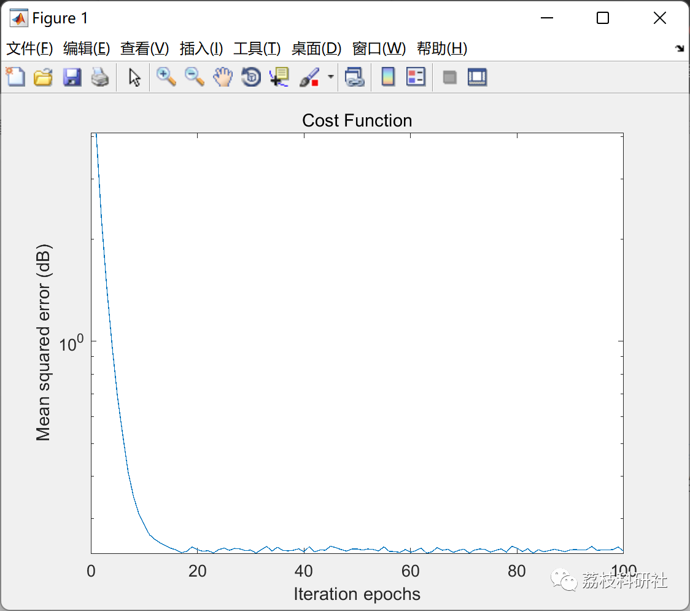
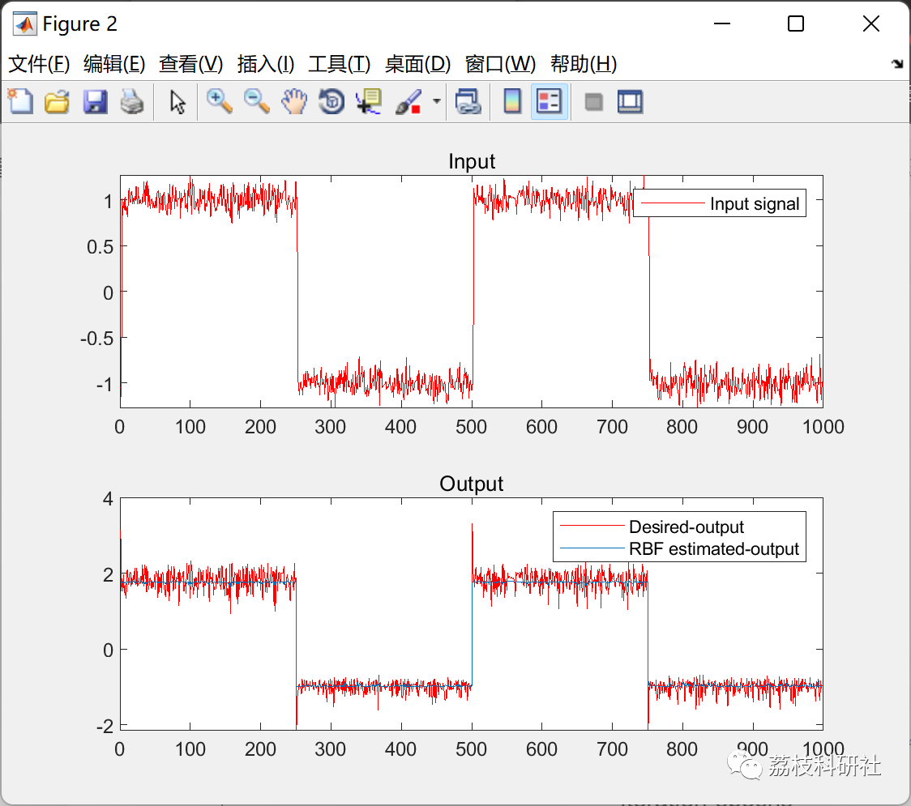

# Nonlinear System Identification Based on RBF Neural Network (Matlab Code Implementation)

💥💥💥💞💞💞 Welcome to this blog❤️❤️❤️ 💥💥💥
🏆 Bloggers' Advantage: 🌞🌞🌞 The content of the blog strives for rigorous thinking and clear logic to facilitate readers.
⛳️ Mantra: A journey of a thousand miles is begun with a single step.
Litchi Research Society
Code Collection: Power Systems, Intelligent Algorithms and Applications, Neural Network Prediction, Path Planning, Optimized Scheduling, Workshop Scheduling, Image Processing, Signal Processing...
🎁 Special Section Links:
🌈🌈🌈🌟🌟🌟 Electrical Code Intelligent Algorithms and Their Applications Path Planning Neural Network Prediction Optimized Scheduling Image Processing Workshop Scheduling Signal Processing Romantic Her Thoughts Math Modeling Complete Code Issues
💥1 Overview
​
In this simulation, the zero-order approximation of RBF-NN for nonlinear systems has been implemented. The simulation includes Monte Carlo simulation settings and RBF NN code. For system estimation, a Gaussian kernel with a fixed center and diffusion is used. The weights and biases of the RBF-NN are optimized using an adaptive learning algorithm based on gradient descent.
📚2 Run Results
🎉3 References
[1] Khan, S., Naseem, I., Togneri, R. et al. Circuits Syst Signal Process (2017) 36: 1639. doi:10.1007/s00034-016-0375-7
🌈4 MATLAB Code Implementation
Click the article below left corner [Read Full Content]

## Images

<!-- PAYMENT_BLOCK -->

## Get this dataset

- Payment link (Stripe): [Buy now](https://buy.stripe.com/3cs8yP7sY87d0vu9AB)
- Payment QR code: 

<!-- /PAYMENT_BLOCK -->
